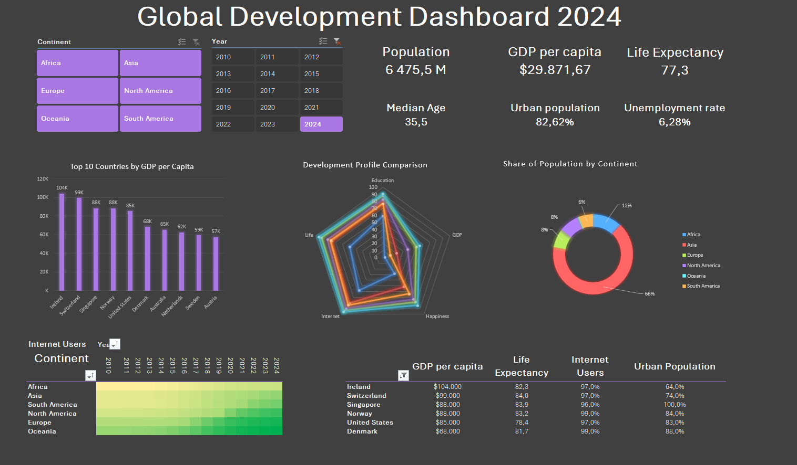

# 🌍 Global Development Dashboard
An interactive Excel dashboard designed to explore and compare global economic, demographic, social, and development indicators across countries from 2010 to 2024.

## 📊 Dashboard Preview

## 🎯 Project Overview
The goal of this project was to transform a multi-year dataset into an interactive Excel dashboard that allows users to explore development indicators across countries and continents.

The dashboard provides a consolidated view of key indicators such as population, GDP per capita, life expectancy, median age, urbanization, unemployment, internet usage, education, and happiness.

Users can filter the dashboard by continent and year to compare countries and observe differences in development patterns.

## 📂 Data Source
The project is based on a curated teaching dataset provided as part of a university course and originally distributed through Kaggle.

The dataset covers economic, demographic, social, environmental, and development indicators for countries across the period 2010–2024.

The underlying indicators are based on established international data sources, including the World Bank, United Nations / Our World in Data, and the World Happiness Report.

For the purposes of the course, selected variables and normalized indices were curated to support comparative analysis and data visualization in Excel

## 🔄 Analysis Workflow
The project started with a raw dataset provided as part of a university course. The analytical structure and dashboard were built independently in Excel.

The project workflow included:

- Exploring the original dataset and selecting relevant development indicators
- Creating Pivot Tables to aggregate and compare data across countries, continents, and years
- Building Pivot Charts based on the prepared analyses
- Creating KPI views for key economic, demographic, and social indicators
- Designing an interactive dashboard from scratch
- Connecting slicers and filters across dashboard elements to enable interactive exploration
- Organizing the workbook into dedicated analysis and visualization sections
- Comparing development patterns across countries and continents
- Interpreting the results and describing observed trends and differences

## 📈 Dashboard Features
- Interactive filters for continent and year
- KPI overview including:
  - Population
  - GDP per capita
  - Life expectancy
  - Median age
  - Urban population
  - Unemployment rate
- Top 10 countries by GDP per capita
- Development profile comparison
- Population distribution by continent
- Internet usage comparison across continents and years
- Country-level comparison of selected development indicators
## 🔎 Key Insights
- Economic development remains highly uneven across regions. In 2024, the highest GDP per capita values in the dataset were concentrated mainly in Europe and other highly developed economies, with Ireland, Switzerland and Singapore among the leading countries.
- Asia dominates the population structure of the dataset. China and India each exceed 1.4 billion inhabitants in 2024, making them the largest contributors to the population represented in the analysis.
- Internet access expanded substantially between 2010 and 2024. A clear digital divide nevertheless remains between regions, with Africa recording the lowest average Internet usage in 2024 at approximately 58%.
- Urbanization increased across all analyzed regions. Oceania and South America were the most urbanized regions in 2024, while Africa recorded the largest increase over the analyzed period.
- Life expectancy shows a long-term upward trend with a visible disruption around 2020. The dataset shows a decline during the pandemic period followed by a strong recovery.
- Higher income is generally associated with higher reported happiness, but the relationship weakens at higher income levels. This suggests that differences in well-being cannot be explained by income alone.
## 🛠️ Tools & Skills
- Microsoft Excel
- Pivot Tables
- Pivot Charts
- Slicers
- Excel formulas
- Conditional formatting
- Data visualization
- KPI design
- Dashboard design
## 📁 Repository Contents
- `Global_Development_Dashboard.xlsx` – full interactive Excel workbook available for download
- `dashboard-preview.png` – dashboard preview
- `README.md` – project documentation
## 💡 Project Purpose
This project demonstrates the use of Excel for data analysis, interactive reporting, and dashboard development. The focus was not only on presenting individual metrics, but also on creating a clear and interactive interface for comparing development indicators across countries, continents, and years.
